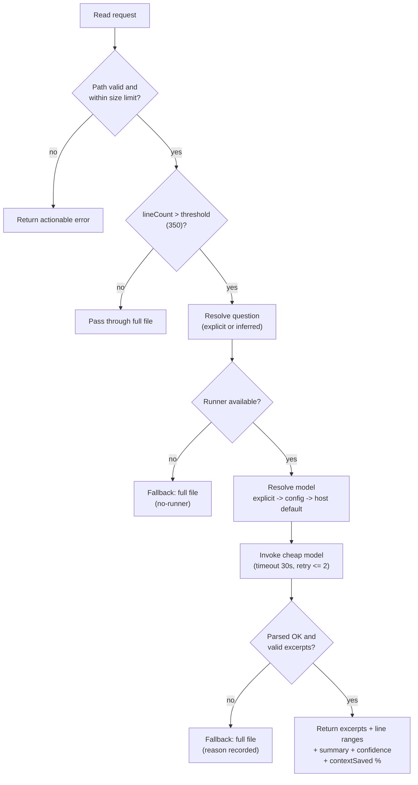

# ContextLens

ContextLens provides harness-native, focused source context for coding agents. It prevents oversized raw-file reads from flooding an agent's context window while keeping inference entirely with the model selected by the host harness.

## Product intent

Support both:

- OpenCode, through its native plugin API
- GitHub Copilot CLI, through supported MCP and hook integration points

## Core mechanism (Spotify Portal pattern)

ContextLens uses a **cheap model (e.g. Haiku) as an intelligent read interceptor**:

- A **hook** intercepts large file reads (over 350 lines by default).
- A **cheap model** infers a question from the agent's task context.
- **Excerpts are returned** in a hybrid format: actual text + line ranges + a one-line summary + a confidence score.
- **Context savings**: roughly 90% reduction when intercepting large files.
- **Cost trade-off**: a ~10-30s cheap-model call is acceptable for intercepted reads.

The expensive agent (selected by the harness) never sees the full large file; it works with bounded excerpts and implicit context, reducing its token consumption dramatically.

## Architecture

A harness-independent core owns path validation, size/line limits, question resolution, bounded reads, and result formatting. Thin adapters plug each host integration into that core. The core depends only on an injected `SubagentRunner` interface, so it is testable without any host installed and isolated from host API drift.


## Read-interception flow

Every read passes through the same decision path. Small files and ranged reads pass through unchanged; only oversized reads are condensed, and any failure falls back to the full file rather than losing data.



Fallback reasons are observable and explicit: `no-runner`, `timeout`, `network-error`, `subagent-error`, `no-valid-excerpts`, `unreadable`, plus parse failures. Each is logged with the model source and attempt count without altering read behaviour.

## Expected behavior

- Intercept or guide oversized source reads before their full contents enter the agent context.
- Provide bounded, deterministic tools for file discovery, line-ranged reads, search, metadata, and concise source selection.
- Preserve normal small-file reads.
- Validate paths, apply project-root boundaries, and return actionable errors.
- Be observable: explain when a read was limited or redirected without exposing unrelated source.

## Non-goals

- Replacing or selecting the harness's primary agent model (the cheap interceptor is supplementary, not a replacement).
- Uploading source code to a ContextLens-operated remote service.
- Depending on the existing Strata file-shunt implementation.

## OpenCode

ContextLens ships two plugin entry points because OpenCode changed its plugin contract:

- **OpenCode v2 (current hosts, e.g. 2.0.30):** auto-discovery loads a project shim whose **default export** is the v2 `{ id, setup }` plugin definition. Create `.opencode/plugins/context-lens.js` and register it in `opencode.jsonc`:

  ```jsonc
  { "plugin": ["context-lens"] }
  ```

  ```js
  // .opencode/plugins/context-lens.js
  export { ContextLensV2Plugin as default } from "context-lens/opencode/plugin-v2";
  ```

- **OpenCode 1.x (legacy factory):** add the plugin to `opencode.json`:

  ```json
  { "plugin": ["context-lens/plugin"] }
  ```

  or re-export it from `.opencode/plugin/context-lens.ts`:
  `export { ContextLensPlugin } from "context-lens/plugin";`

The cheap model is chosen from `CONTEXT_LENS_MODEL="provider/model"`, else `.context-lens/config.json` or `~/.config/context-lens/config.json`, else the host default.

Native `read` results over 350 lines are condensed into excerpts with line ranges and a confidence score. Small files and ranged reads (`offset`/`limit`) pass through unchanged.

## Copilot CLI

The Copilot CLI adapter provides two supported surfaces: an extension `onPostToolUse` view hook for automatic oversized-read interception, and the explicit `context_lens_read(path, question, start_line?, end_line?)` MCP tool. The MCP tool routes an explicit question through the same core interceptor; a `start_line` or `end_line` range is always returned raw and never condensed.

### Extension (automatic view interception)

Build ContextLens first:

```bash
npm run build
```

Install a shim at `.github/extensions/context-lens/extension.mjs` for one project, or at `~/.copilot/extensions/context-lens/extension.mjs` for user scope. The shim must point its second import at the absolute `file://` URL of this built checkout's dist entry:

```js
import { joinSession } from "@github/copilot-sdk/extension";
import { registerContextLens } from "file:///abs/path/to/context-lens/dist/copilot-cli/extension-entry.js";
await registerContextLens(joinSession);
```

The Copilot host resolves `@github/copilot-sdk/extension`; ContextLens has no runtime dependency on it. `view` results over 350 lines are condensed into excerpts with ranges and confidence. Small files, `view_range` views, directories, and non-view tools pass through unchanged. Any failure returns the full file.

`CONTEXT_LENS_MODEL` forwards only its model ID as `--model`; when unset, the host default is used. `CONTEXT_LENS_LOG_FILE` is the JSONL diagnostics sink for `intercepted` and `fallback` records. `CONTEXT_LENS_CHILD=1` is set automatically on a child `copilot -p` subagent so a child-side ContextLens remains inert. For non-interactive `copilot -p`, the live harness sets `GITHUB_COPILOT_PROMPT_MODE_EXTENSIONS=true` to load extensions.

### MCP server

Configure the stdio server in `~/.copilot/mcp-config.json`:

```json
{"mcpServers":{"context-lens":{"type":"local","command":"node","args":["/abs/path/to/context-lens/dist/copilot-cli/mcp-entry.js"],"tools":["*"]}}}
```

Or use an equivalent project-local configuration for one invocation:

```bash
copilot --additional-mcp-config @mcp-config.json
```

If the model, file, or parsing path fails, `context_lens_read` returns the full file rather than dropping context. Model choice follows `CONTEXT_LENS_MODEL`, then project configuration, then global configuration.

### Live harness

An authenticated Copilot CLI is required for the opt-in live harness:

```bash
npm run build && CONTEXT_LENS_E2E=1 node scripts/e2e-copilot.mjs
```

It runs the happy, pass-through, MCP, and bogus-model scenarios against copilot 1.0.98 in isolated temporary projects and prints PASS or FAIL for each scenario (a failing scenario is retried once). Each run uses a throwaway `COPILOT_HOME` that holds only copies of `~/.copilot/config.json` and `settings.json` (the latter carries the `experimental` flag that enables extensions), so user-level hooks, MCP servers and instructions do not apply; set `CONTEXT_LENS_E2E_SHARED_HOME=1` to use the real `~/.copilot` instead. Without the gate, it prints `SKIP copilot e2e (set CONTEXT_LENS_E2E=1)` and exits 0.

## Development

```bash
npm run build      # compile TypeScript to dist/
npm test           # run node --test against dist/**/*.test.js
npm run type-check # tsc --noEmit
```

> Note: the test glob `dist/**/*.test.js` is not expanded recursively by the shell. Test files must live exactly one directory under `src/` (e.g. `src/core/*.test.ts`, `src/opencode/*.test.ts`) so they compile to `dist/core/*.test.js` / `dist/opencode/*.test.js` and are picked up.

## Implementation status

- **Phase 1 - Core interceptor** (cheap model + excerpt extraction, path/size guards, model selection, transient retry/timeout). Complete.
- **Phase 2 - OpenCode adapter** (v1 factory + v2 `{id, setup}` plugin, child-session runner, model config persistence, live host-contract e2e). Complete - Milestone M001.
- **Phase 3 - Copilot CLI adapter** (extension view hook, model config + error matrix, `context_lens_read` MCP server, install path, opt-in live harness). Complete - Milestone M002.
