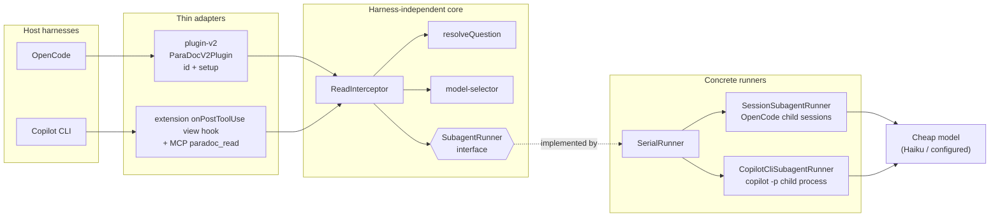
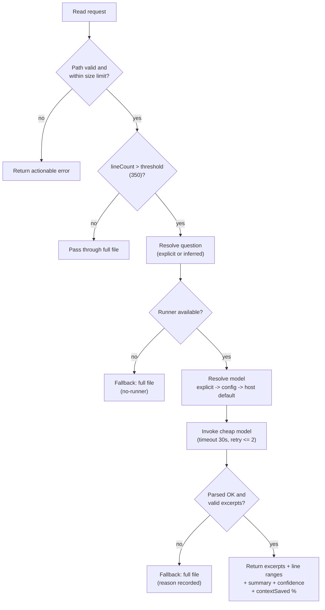

<p align="center"></p>

# ParaDoc

ParaDoc provides harness-native, focused source context for coding agents. It prevents oversized raw-file reads from flooding an agent's context window while keeping inference entirely with the model selected by the host harness.

## Install

```bash
npx -y @davidnagy/paradoc install            # OpenCode + Copilot CLI, user scope
npx -y @davidnagy/paradoc install opencode   # or: copilot
npx -y @davidnagy/paradoc install opencode --project   # ./.opencode instead of ~/.config/opencode
```

Until the package is on npm, install straight from GitHub: `npx -y github:nagydavid/paradoc install`.

This copies the built runtime to `~/.local/share/paradoc` and writes the host shims (`~/.config/opencode/plugins/paradoc.js`, `~/.copilot/extensions/paradoc/extension.mjs`). Re-run it to upgrade. Restart the host afterwards. The manual setup below is only needed for custom layouts.

## Product intent

Support both:

- OpenCode, through its native plugin API
- GitHub Copilot CLI, through supported MCP and hook integration points

## Core mechanism (Spotify Portal pattern)

ParaDoc uses a **cheap model (e.g. Haiku) as an intelligent read interceptor**:

- A **hook** intercepts large file reads (over 350 lines by default).
- A **cheap model** infers a question from the agent's task context.
- **Excerpts are returned** in a hybrid format: actual text + line ranges + a one-line summary + a confidence score.
- **Context savings**: roughly 90% reduction when intercepting large files.
- **Cost trade-off**: a ~10-30s cheap-model call is acceptable for intercepted reads.

The expensive agent (selected by the harness) never sees the full large file; it works with bounded excerpts and implicit context, reducing its token consumption dramatically.

## Architecture

A harness-independent core owns path validation, size/line limits, question resolution, bounded reads, and result formatting. Thin adapters plug each host integration into that core. The core depends only on an injected `SubagentRunner` interface, so it is testable without any host installed and isolated from host API drift.



## Read-interception flow

Every read passes through the same decision path. Small files and ranged reads pass through unchanged; only oversized reads are condensed, and any failure falls back to the full file rather than losing data.



Fallback reasons are observable and explicit: `no-runner`, `timeout`, `network-error`, `subagent-error`, `no-valid-excerpts`, `unreadable`, plus parse failures. Each is logged with the model source and attempt count without altering read behaviour.

## Expected behavior

- Intercept or guide oversized source reads before their full contents enter the agent context.
- Provide bounded, deterministic tools for file discovery, line-ranged reads, search, metadata, and concise source selection.
- Preserve normal small-file reads.
- Validate paths, apply project-root boundaries, and return actionable errors.
- Be observable: explain when a read was limited or redirected without exposing unrelated source.

## Non-goals

- Replacing or selecting the harness's primary agent model (the cheap interceptor is supplementary, not a replacement).
- Uploading source code to a ParaDoc-operated remote service.
- Depending on the existing Strata file-shunt implementation.

## OpenCode

ParaDoc ships two plugin entry points because OpenCode changed its plugin contract:

- **OpenCode v2 (current hosts, e.g. 2.0.30):** auto-discovery loads a project shim whose **default export** is the v2 `{ id, setup }` plugin definition. Create `.opencode/plugins/paradoc.js` and register it in `opencode.jsonc`:

  ```jsonc
  { "plugin": ["@davidnagy/paradoc"] }
  ```

  ```js
  // .opencode/plugins/paradoc.js
  export { ParaDocV2Plugin as default } from "@davidnagy/paradoc/opencode/plugin-v2";
  ```

- **OpenCode 1.x (legacy factory):** add the plugin to `opencode.json`:

  ```json
  { "plugin": ["@davidnagy/paradoc/plugin"] }
  ```

  or re-export it from `.opencode/plugin/paradoc.ts`:
  `export { ParaDocPlugin } from "@davidnagy/paradoc/plugin";`

The cheap model is chosen from `PARADOC_MODEL="provider/model"`, else `.paradoc/config.json` or `~/.config/paradoc/config.json`, else the host default.

Native `read` results over 350 lines (and at least ~1,000 estimated tokens) are condensed into excerpts with line ranges, a confidence score and a list of omitted ranges. Cheap files and ranged reads (`offset`/`limit`) pass through unchanged; very wide files (~8,000+ estimated tokens, e.g. minified or generated) are condensed even under 350 lines. Token counts are estimated as chars/4.

Identical repeat reads are served from the in-memory result cache with no model call (see [Cache](#cache)). Tune the eligibility floors with `minTokens` and `thresholdTokens` on `ReadInterceptor`. `interceptor.stats()` returns measured counts and delegation time plus *estimated* token savings; the same running totals are attached as `stats` to each existing log event. Nothing leaves the process.

Measure the effect on your own files with `npm run build && node scripts/bench-tokens.mjs [file ...]` (uses a fake runner: counts and token figures are estimates, not live latency).

Not done (document-only): a real tokenizer, persistent or semantic caching, and deriving questions from assistant turns - each adds dependencies or state disproportionate to the gain.

## Copilot CLI

The Copilot CLI adapter provides two supported surfaces: an extension `onPostToolUse` view hook for automatic oversized-read interception, and the explicit `paradoc_read(path, question, start_line?, end_line?)` MCP tool. The MCP tool routes an explicit question through the same core interceptor; a `start_line` or `end_line` range is always returned raw and never condensed.

### Extension (automatic view interception)

Build ParaDoc first:

```bash
npm run build
```

Install a shim at `.github/extensions/paradoc/extension.mjs` for one project, or at `~/.copilot/extensions/paradoc/extension.mjs` for user scope. The shim must point its second import at the absolute `file://` URL of this built checkout's dist entry:

```js
import { joinSession } from "@github/copilot-sdk/extension";
import { registerParaDoc } from "file:///abs/path/to/paradoc/dist/copilot-cli/extension-entry.js";
await registerParaDoc(joinSession);
```

The Copilot host resolves `@github/copilot-sdk/extension`; ParaDoc has no runtime dependency on it. `view` results over 350 lines are condensed into excerpts with ranges and confidence. Small files, `view_range` views, directories, and non-view tools pass through unchanged. Any failure returns the full file.

`PARADOC_MODEL` forwards only its model ID as `--model`; when unset, the host default is used. `PARADOC_LOG_FILE` is the JSONL diagnostics sink for `intercepted` and `fallback` records. `PARADOC_CHILD=1` is set automatically on a child `copilot -p` subagent so a child-side ParaDoc remains inert. For non-interactive `copilot -p`, the live harness sets `GITHUB_COPILOT_PROMPT_MODE_EXTENSIONS=true` to load extensions.

### MCP server

Configure the stdio server in `~/.copilot/mcp-config.json`:

```json
{"mcpServers":{"paradoc":{"type":"local","command":"node","args":["/abs/path/to/paradoc/dist/copilot-cli/mcp-entry.js"],"tools":["*"]}}}
```

Or use an equivalent project-local configuration for one invocation:

```bash
copilot --additional-mcp-config @mcp-config.json
```

If the model, file, or parsing path fails, `paradoc_read` returns the full file rather than dropping context. Model choice follows `PARADOC_MODEL`, then project configuration, then global configuration.

### Live harness

An authenticated Copilot CLI is required for the opt-in live harness:

```bash
npm run build && PARADOC_E2E=1 node scripts/e2e-copilot.mjs
```

It runs the happy, pass-through, MCP, bogus-model, large, cache-repeat, and judge scenarios (select one with `--scenario <name|all>`) against copilot 1.0.98 in isolated temporary projects and prints PASS or FAIL for each scenario (a failing scenario is retried once). Each run uses a throwaway `COPILOT_HOME` that holds only copies of `~/.copilot/config.json` and `settings.json` (the latter carries the `experimental` flag that enables extensions), so user-level hooks, MCP servers and instructions do not apply; set `PARADOC_E2E_SHARED_HOME=1` to use the real `~/.copilot` instead. Without the gate, it prints `SKIP copilot e2e (set PARADOC_E2E=1)` and exits 0.

## Tuning

Tuning lives in an optional `tuning` block of the same config file that stores the model choice: `.paradoc/config.json` (project) or `$XDG_CONFIG_HOME/paradoc/config.json`, i.e. `~/.config/paradoc/config.json` (global).

```json
{
  "version": 1,
  "model": { "providerID": "anthropic", "modelID": "claude-haiku-4-5" },
  "tuning": { "thresholdLines": 500, "chunkLines": 1000, "concurrency": 3, "judge": "low-confidence" }
}
```

Saving a model choice preserves an existing `tuning` block.

| Key | Env override | Default | Meaning |
| --- | --- | --- | --- |
| `thresholdLines` | `PARADOC_THRESHOLD` | 350 | Reads above this many lines are condensed (integer >= 1) |
| `timeoutMs` | `PARADOC_TIMEOUT_MS` | 30000 | Deadline for the cheap-model work on one read (>= 1) |
| `concurrency` | `PARADOC_CONCURRENCY` | 1 | Max concurrent chunk subagents (>= 1) |
| `chunkLines` | `PARADOC_CHUNK_LINES` | 0 (off) | Window size for chunked reads |
| `chunkOverlapLines` | `PARADOC_CHUNK_OVERLAP` | `min(50, chunkLines - 1)` | Lines shared by neighbouring windows; must be smaller than `chunkLines` |
| `judge` | `PARADOC_JUDGE` | `off` | `off`, `low-confidence` or `always` |
| `cacheMaxEntries` | `PARADOC_CACHE` | 64 | Result cache size; `0` (or `off` in the env) disables it |

Precedence per key: explicit adapter options, then environment, then project config, then global config, then the defaults. An invalid value logs a `paradoc: ignoring ...` warning and falls through to the next source (or the default); it never fails a read.

### Parallel chunked reads

With `chunkLines` set above 0, a file longer than `chunkLines` is split into overlapping windows that are answered by the cheap model concurrently, up to `concurrency`, under one shared deadline (`timeoutMs`). Excerpts keep absolute line numbers and are merged into one result. If any chunk fails, the full file is returned with a `chunk i/n: ...` detail. Chunking is off by default, and `concurrency` defaults to 1, so enable both deliberately.

### Judge

`judge` adds a second cheap-model pass that checks whether the excerpts answer the question. Modes: `off`, `low-confidence` (only when the first pass reports low confidence) and `always`. Only an explicit `insufficient` verdict returns the full file, with `fallbackReason=judge-rejected`. A judge error, timeout or invalid output keeps the excerpts and logs a warning.

### Cache

Results are cached in memory, per host process, keyed by the file's SHA-256, the question, the model, the prompt version, the chunk configuration and the judge mode. Only intercepted results are stored (fallbacks and results with a judge error are not). The cache is bounded to `cacheMaxEntries` entries and about 4 MB. `PARADOC_CACHE=off` or `0` disables it. Concurrent identical reads (same key, e.g. an agent issuing the same `read` twice in one step) share one runner call: the later reads wait for the first and are served with `cacheHit=true`; if the first falls back, each later read runs its own call. One-shot `copilot -p` and `opencode run` processes only reuse results within that single run.

### Reading the logs

```text
intercepted <path> (<n> lines, confidence C, chunks=N, cacheHit=true, judge=<verdict>, <ms>ms)
fallback <reason> for <path>: <detail>
```

`chunks=`, `cacheHit=true` and `judge=` appear only when they apply (`judge=error` marks a judge failure, followed by ` judge error: <detail>`). Judge errors log at warn level. Copilot writes these to `PARADOC_LOG_FILE`.

### Benchmark

```bash
npm run build && node scripts/bench.mjs [--iterations N] [--latency MS]
```

A hermetic benchmark with a fake runner (no host or network; defaults 20 iterations, 25 ms latency). It prints p50 and p95 for serial, parallel and cached chunked reads, plus `contextSaved`.

## Development

```bash
npm run build      # compile TypeScript to dist/
npm test           # run node --test against dist/**/*.test.js
npm run type-check # tsc --noEmit
```

> Note: the test glob `dist/**/*.test.js` is not expanded recursively by the shell. Test files must live exactly one directory under `src/` (e.g. `src/core/*.test.ts`, `src/opencode/*.test.ts`) so they compile to `dist/core/*.test.js` / `dist/opencode/*.test.js` and are picked up.

## Implementation status

- **Phase 1 - Core interceptor** (cheap model + excerpt extraction, path/size guards, model selection, transient retry/timeout). Complete.
- **Phase 2 - OpenCode adapter** (v1 factory + v2 `{id, setup}` plugin, child-session runner, model config persistence, live host-contract e2e). Complete - Milestone M001.
- **Phase 3 - Copilot CLI adapter** (extension view hook, model config + error matrix, `paradoc_read` MCP server, install path, opt-in live harness). Complete - Milestone M002.
- **Phase 4 - Advanced features** (parallel chunked reads, optional judge, result cache, tuning config, benchmark; live harnesses with `--scenario` for OpenCode: happy/persist/fallback/large/cache/judge). Milestone M003. Defaults: chunking off, judge off, concurrency 1.
